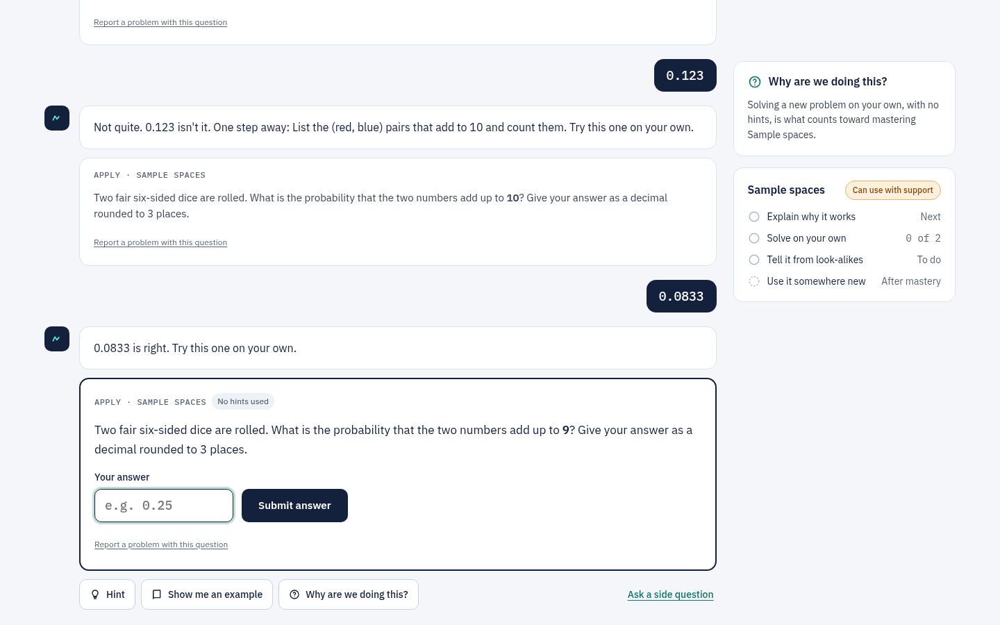
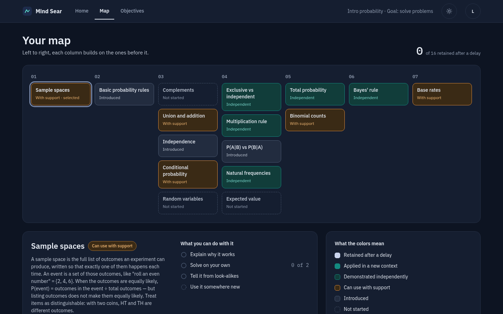

# Mind Sear

**An adaptive tutor that sears concepts into the mind.** Give it a learning objective (a one-line goal, or
documents like a job posting or a syllabus) and it compiles a plan, then teaches one topic at a time until you can
explain it, solve new problems with it on your own, and still do so days later.

<p align="center">
  
  
</p>

## How it works

Language models plan, teach and interpret. Deterministic code makes every decision that has to be trustworthy:

- **Grading.** Answers with a computable key are checked by code. Only explanations go to a model, and a low-confidence
  grade counts for less.
- **Learner model.** Bayesian Knowledge Tracing, weighted by how much help you had. An answer given after a hint
  counts for less than one with no help, and an answer after a worked step counts for nothing.
- **Mastery gate.** A topic is marked _demonstrated independently_ only after two unassisted solves of distinct
  problems, every capability the goal asks for, high estimated knowledge, and no open misconception. It is marked
  _retained_ after you pass a spaced review at least three days later.
- **Teaching policy.** A pure function picks the next move: instruct, worked example, probe a suspected misconception,
  climb the hint ladder, contrast confusable ideas, or review. The model writes the words, not the decision.
- **Scheduling.** Reviews are spaced with FSRS and pulled in to land before your deadline.

Every piece of evidence is appended to a log that is never edited, and all derived state can be rebuilt by replaying it. See
[docs/architecture.md](docs/architecture.md) for the full design.

### Two ways to learn

1. **Library courses** ship as TypeScript content packs, written by hand and validated by property tests. They run
   without a model, which is only needed to grade written explanations. One pack is included: _Intro probability_
   (16 topics, 113 item templates).
2. **Your own objective.** The objective compiler reads your goal and documents, asks a few scoping questions, and
   drafts a knowledge graph grounded in your sources. It then writes items for each topic and cross-checks them before
   you see the plan. You can review and edit the plan in plain language before accepting it.

## Quick start

Requires **Node.js 26** or later, which runs the TypeScript sources directly with no build step for the server.

```sh
git clone https://github.com/quinnovator/mindsear.git
cd mindsear
npm install
npm run build             # build the web client
cp .env.example .env      # add ANTHROPIC_API_KEY (optional, see below)
npm start                 # http://localhost:8787
```

For development, run the API and the Vite dev server side by side:

```sh
npm run dev               # API on :8787, restarts on change
npm run dev:web           # web client on :5173 with hot reload, proxying /api
```

**Without an API key** the library course still works end to end: answers are code-graded and the tutor uses scripted
messages. Free-text answers are marked "couldn't grade" and count for nothing, and new objectives can't be compiled.

## Configuration

All configuration is environment variables. `npm start` and `npm run dev` load `.env` if it exists.

| Variable             | Default              | Purpose                                                                              |
| -------------------- | -------------------- | ------------------------------------------------------------------------------------ |
| `ANTHROPIC_API_KEY`  |                      | Use the Claude API.                                                                  |
| `OPENROUTER_API_KEY` |                      | Use Claude through OpenRouter's Anthropic-compatible endpoint (if no Anthropic key). |
| `MODEL_<ROLE>`       | see below            | Override the model for one role, e.g. `MODEL_TUTOR=claude-sonnet-5-5`.               |
| `HOST`               | `127.0.0.1`          | Interface to listen on. The Docker image sets `0.0.0.0`.                             |
| `PORT`               | `8787`               | Port to listen on.                                                                   |
| `DB_PATH`            | `./data/mindsear.db` | SQLite database file. Created on first run.                                          |
| `LOCAL_USER`         | `learner@localhost`  | The single user when `AUTH_HEADER` is unset.                                         |
| `AUTH_HEADER`        |                      | Trust this request header as the user's email (see [Deployment](#deployment)).       |
| `AUTH_NAME_HEADER`   |                      | Optional header carrying the user's display name.                                    |
| `WEB_DIST`           | `./web/dist`         | Built web client to serve.                                                           |

### Models

Each role is a separate call with its own prompt and a schema-validated output. Every call is logged to the `llm_call`
table.

| Role                                                                                                           | Default    | Job                                                                      |
| -------------------------------------------------------------------------------------------------------------- | ---------- | ------------------------------------------------------------------------ |
| `tutor`                                                                                                        | Opus 5.5   | Writes each tutor message for the move the policy chose (streamed).      |
| `assessor`                                                                                                     | Opus 5.5   | Grades free-text explanations against a rubric and names misconceptions. |
| `planner`                                                                                                      | Sonnet 5.5 | Chooses which misconception probe to ask next.                           |
| `item_writer`, `verifier`                                                                                      | Haiku 5.5  | Rewrite an item's surface text; check that the rewrite didn't change it. |
| `ingester`, `scoper`, `researcher`, `curriculum`, `misconceptions`, `templates`, `cross_checker`, `red_teamer` | Opus 5.5   | The objective compiler.                                                  |

## Deployment

Mind Sear is one Node process with a SQLite file, so any host with a persistent volume works. The included `Dockerfile`
builds a small image that runs as a non-root user and keeps its data in `/data`:

```sh
docker build -t mindsear .
docker run -p 127.0.0.1:8787:8080 -v mindsear-data:/data -e ANTHROPIC_API_KEY=... mindsear
```

**Authentication is delegated to a reverse proxy.** By default the app is single-user and anyone who can reach the port
is that user. To serve several people, put it behind a proxy that authenticates every request and sets an identity
header, then name that header in `AUTH_HEADER`. The proxy must also strip any copy of that header sent by the client.

| Proxy                                                  | `AUTH_HEADER`          | `AUTH_NAME_HEADER`    |
| ------------------------------------------------------ | ---------------------- | --------------------- |
| [Tailscale Serve](https://tailscale.com/kb/1312/serve) | `Tailscale-User-Login` | `Tailscale-User-Name` |
| [oauth2-proxy](https://oauth2-proxy.github.io/)        | `X-Forwarded-Email`    | `X-Forwarded-User`    |

## Project layout

```
shared/        API and content-pack contracts shared by server and client
server/
  index.ts     HTTP API (Hono), SSE streams, static web client
  db.ts        SQLite schema (node:sqlite)
  llm.ts       Model roles, per-model thinking settings, call logging
  engine/      Pure, unit-tested logic: BKT, mastery gate, diagnosis, teaching policy, FSRS scheduler, grading
  pipeline/    The turn pipeline: assess → update learner model → choose move → build item → stream tutor message
  compiler/    The objective compiler: ingest → scope → research → graph → items → cross-check → plan
  content/     Pack validation, course assembly and the bundled intro-probability pack
web/           React 19 client (Vite), plain CSS with light and dark themes
test/          Engine unit tests, simulated learners playing full sessions, pack property tests
docs/          Architecture notes and screenshots
```

## Development

```sh
npm run check        # everything CI runs: format, typecheck, tests, pack validation
npm test             # unit tests and simulated-learner sessions (no model calls)
npm run pack:check   # validate content packs: prerequisite cycles, coverage, 1,000-sample property tests
npm run format       # format with Prettier
```

Contributions are welcome. See [CONTRIBUTING.md](CONTRIBUTING.md).

## Status and limitations

Mind Sear is early (0.1). Known gaps:

- **Hands-on practice** is asked about rather than done. There is no code sandbox, so practical topics use realistic
  scenarios, traces and configs as multiple-choice and explain items.
- **Research** fetches the canonical URLs the Researcher proposes (public hosts only) rather than running a web search.
  A page that doesn't load is dropped.
- **Library reuse** matches existing topics by key, not by embedding similarity.
- **Plan compilation** takes about four minutes for a 24-topic plan, and modules stream in as they finish.
- **No email**, so due reviews appear on the home screen instead of in your inbox.

## License

[MIT](LICENSE)
